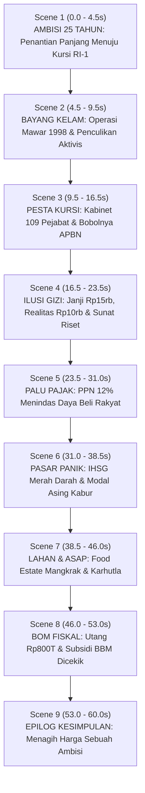

# Implementation Plan: Video Motion 60 Detik — "The Red Kingdom: Ambisi, Pesta Kursi & Badai Awal"

Rencana desain teknis, struktur narasi sarkastik, integrasi aset gambar berfilter khusus, dan arsitektur kode Remotion 60 detik (1 menit) dengan standar [PANDUAN-VIDEO-MOTION.md](file:///Users/wira-lap001/Downloads/motion/PANDUAN-VIDEO-MOTION.md). Dokumen ini dirancang agar siap dieksekusi secara presisi dan dapat dijadikan referensi cetak biru untuk model AI lainnya.

---

## 1. Goal Description

Meningkatkan skala video dari 30 detik menjadi **60 detik (1 menit penuh / 120 beats @ 120 BPM)** dengan tema **Dark Political Thriller / Satire Editorial**. Video ini menggabungkan:
1. **Mood Lebih Dark & Dramatis**: Palet hitam pekat, merah darah, kontras tajam ala *noir/thriller*, bayangan tebal, dan teks kinetik tajam.
2. **Naskah Sarkastik & Tajam**: Gaya bahasa satir cerdas yang menyindir kontradiksi antara janji manis kampanye dengan realitas kebijakan yang menekan rakyat.
3. **Data Lebih Padat & Spesifik**: Fakta angka nyata (Kabinet 109 pejabat, utang jatuh tempo Rp 800 T, anggaran MBG Rp 71 T vs Rp 10.000/porsi, PPN 12%, anjloknya IHSG, Karhutla, dan subsidi BBM).
4. **Sistem Integrasi Gambar Terpadu (`<EditorialImage />`)**: Pemrosesan gambar/foto nyata menggunakan filter *high-contrast duotone*, *film grain*, dan *torn-paper/halftone mask*, sehingga gambar apa pun yang dimasukkan akan menyatu secara organik ke dalam tema dark tanpa terlihat seperti tempelan asal.

---

## 2. User Review Required

> [!IMPORTANT]
> **Integrasi Gambar & Foto Nyata**:
> Untuk mencegah foto merusak estetika *dark motion graphics*, kami membuat komponen khusus `<EditorialImage src={...} />` yang secara otomatis mengubah foto apa pun menjadi:
> - **Grayscale berkarakter** (`contrast(150%) brightness(85%)`)
> - **Duotone merah-arang** (`mixBlendMode: 'luminosity'` / overlay merah gelap)
> - **Tekstur koran investigasi / grain film**
> Apakah Anda sudah menyiapkan file foto sendiri (misal foto resmi Prabowo, foto pelantikan kabinet, foto nampan MBG) di folder `public/`, atau ingin kami sediakan aset visual ilustratif & mockup editorial bawaan yang siap pakai?

> [!WARNING]
> **Tingkat Satire & Ketajaman Narasi**:
> Gaya sarkastik yang diusulkan adalah **satire jurnalistik berbasis fakta** (menelanjangi kontradiksi kebijakan tanpa fitnah personal):
> - *Contoh Hook*: *"25 tahun berjuang demi satu tahta... Begitu duduk, langsung bagi-bagi kursi."*
> - *Contoh Kabinet*: *"Katanya efisiensi anggaran... Tapi menterinya dibikin 109 orang. Kalau bisa boros, kenapa harus hemat?"*
> - *Contoh Pajak*: *"Makan gratis dijanjikan, tapi belanja harian dipajaki 12%. Mengambil dari kantong kiri untuk piring kanan."*

---

## 3. Open Questions

1. **Aset Foto Pendukung**:
   - a) Pakai mockup editorial & siluet grafis bawaan kami yang sudah terfilter sinematik *(Rekomendasi jika belum ada file foto)*.
   - b) Saya akan meletakkan beberapa file gambar/foto di `public/assets/` untuk dipakai di tiap adegan.
2. **Karakter Narasi & Suara**:
   - a) Narasi murni teks tipografi kinetik berbobot + musik tensi berat & dentuman SFX *(Rekomendasi)*.
   - b) Ingin disediakan slot audio voiceover/narasi eksternal jika nanti ingin diisi rekaman suara.

---

## 4. Alur 9 Adegan (60 Detik / 120 Beat @ 120 BPM)



### Breakdown Adegan & Script Satir 60 Detik

| Scene | Durasi | Narasi Teks Kinetik & Sarkasme | Visual Metafora & Aset Foto | Audio Cue / SFX |
|---|---|---|---|---|
| **1. Ambisi 25 Tahun** | 0.0 – 4.5s (9 beat) | *"25 TAHUN BERJUANG DEMI SATU TAHTA... DARI MILITER HINGGA KURSI RI-1. AKHIRNYA BERKUASA."* | Siluet jenderal bertransformasi ke kursi kepresidenan emas megah berpadu bintang empat. | Clock ticking tensi + impact dentuman berat |
| **2. Operasi Mawar 1998** | 4.5 – 9.5s (10 beat) | *"NAMUN SEJARAH TAK BISA DIHAPUS: OPERASI MAWAR 1998. DULU MEMBURU AKTIVIS DEMOKRASI, KINI MEMERINTAH DI ATASNYA."* | Dokumen arsip militer terstempel merah "TIM MAWAR 1998", mawar berduri merah terbakar, foto arsip demonstrasi 1998. | Suara radio statis militer + thud tajam |
| **3. Pesta Kabinet** | 9.5 – 16.5s (14 beat) | *"KATANYA EFISIENSI... MALAH BIKIN KABINET TERGEMUK SEJARAH: 109 PEJABAT! KALAU BISA BOROS, KENAPA HARUS HEMAT?"* | Counter angka melesat 0 → 109, foto barisan pejabat di-duotone merah dengan stempel *"BAGI-BAGI KUE"*. | Ticks beruntun mesin kasir + stempel benturan keras |
| **4. Ilusi MBG** | 16.5 – 23.5s (14 beat) | *"JANJINYA MAKAN BERGIZI... ANGGARANNYA DISUNAT JADI 10 RIBU. PERUT KENYANG DI BALIHO, ANGGARAN RISET DIOBRAL."* | Nampan makanan menyusut drastis, gunting memotong pos anggaran pendidikan. | Whoosh piring + suara gunting tajam |
| **5. Palu Pajak** | 23.5 – 31.0s (15 beat) | *"HADIAH MANIS: PPN 12%! MAKAN DIJANJIKAN, BELANJA DICEKIK. DARI KANTONG RAKYAT, KEMBALI KE BIROKRAT."* | Palu raksasa menghantam dompet rakyat, stempel merah menekan layar dengan camera shake keras. | Breakdown musik hening + dentuman palu godam |
| **6. IHSG Berdarah** | 31.0 – 38.5s (15 beat) | *"INVESTOR KABUR, IHSG TERJUN BEBAS KE ZONA MERAH. PEJABAT: 'EKONOMI KITA TERKUAT!'"* | Grafik candlestick merah anjlok menembus dasar layar, alarm bursa darurat berkedip merah. | Nada riser turun curam + alarm dengung tegang |
| **7. Lahan & Asap** | 38.5 – 46.0s (15 beat) | *"FOOD ESTATE MANGKRAK, HUTAN BERASAP. PROYEK AMBISI MILITER, RAKYAT DAPAT KABUT."* | Hutan terbakar kobaran api karhutla, traktor mangkrak di tanah gersang, overlay asap tebal. | Suara desis api (*shimmer*) + gemuruh angin kencang |
| **8. Bom Utang & BBM** | 46.0 – 53.0s (14 beat) | *"SUBSIDI BBM DICABUT, UTANG JATUH TEMPO RP 800 TRILIUN. SELAMAT MENIKMATI KEMANDIRIAN!"* | Meteran SPBU berputar gila-gilaan, grafik utang melambung tinggi menimpa rakyat. | Riser build-up drum roll + sirene peringatan bahaya |
| **9. Epilog Kesimpulan** | 53.0 – 60.0s (14 beat) | *"DULU AKTIVIS DILENYAPKAN, KINI ANGGARAN DIBOROSKAN, RAKYAT DIHIMPIT PAJAK... KETIKA 25 TAHUN AMBISI TERBAYAR LUNAS: SIAPA SEBENARNYA YANG SEDANG DISELAMATKAN?"* | Mahkota retak menimpa peta Indonesia yang terbakar, teks kesimpulan tajam, tanpa embel-embel medsos/komentar. | Akord minor Dm penutup yang bergaung dingin + dentuman sub-bass akhir |

---

## 5. Efisiensi Eksekusi (Direct Production)

> [!TIP]
> **Optimasi Token & Waktu**:
> Sesuai arahan Anda, pengujian parsial/still frame berulang akan dilewati. Eksekusi kode dilakukan langsung secara presisi:
> 1. Sinkronisasi timing 60s di `make_cues.py`.
> 2. Sintesis audio DSP 60s di `make_audio.py` langsung ke `-14 LUFS`.
> 3. Implementasi komponen 8 adegan dan `<EditorialImage />` di Remotion.
> 4. Render final langsung ke file MP4 60 detik.

---

## 5. Proposed Changes & Technical Architecture

### Component 1: Timing & Cues Engine (60 Detik)
#### [MODIFY] `make_cues.py`
* Durasi diatur menjadi `60.0` detik.
* 7 titik batas adegan: `[6.5, 13.5, 20.5, 28.0, 36.0, 44.0, 52.0]`.
* Pemetaan SFX sinkron: dentuman stempel, suara mesin tik, gunting, palu pajak, alarm bursa saham, dan desis api.

#### [MODIFY] `src/cues.json`
* Dihasilkan otomatis oleh `make_cues.py` sebagai sumber tunggal durasi komposisi Remotion (1800 frame @ 30 fps).

---

### Component 2: Sound Design & Procedural Audio DSP
#### [MODIFY] `make_audio.py`
* Struktur musik 60 detik (30 bar pada 120 BPM).
* Progresi akord minor dramatis berbobot: `Dm - Bb - Gm - A` berulang dengan variasi arpeggio plucking lebih rapat.
* 2 Breakdown hening untuk memberi ruang dampak satir: pada momen Pajak PPN (Scene 4) dan momen IHSG Crash (Scene 5).
* Normalisasi EBU R128 via FFmpeg `loudnorm` ke standar siaran **`-14 LUFS`** dan True Peak **`≤ -1.2 dBFS`**.

---

### Component 3: Image Pipeline & Dark Styling Kit
#### [MODIFY] `src/Kit.tsx`
Menambahkan helper visual khusus untuk aset foto nyata:
```tsx
// Komponen integrasi foto agar menyatu 100% ke tema Dark Political Thriller
export const EditorialImage: React.FC<{
  src: string;
  frame: number;
  width?: number;
  height?: number;
  tint?: 'red' | 'gold' | 'monochrome';
  zoom?: boolean;
}> = ({src, frame, width = 600, height = 400, tint = 'red', zoom = true}) => {
  const z = zoom ? 1 + (frame * 0.0008) : 1;
  return (
    <div style={{
      width, height, overflow: 'hidden', borderRadius: 20,
      border: `3px solid ${tint === 'red' ? '#C8372D' : '#C9A227'}`,
      boxShadow: '0 24px 60px rgba(0,0,0,0.8)', position: 'relative'
    }}>
      
      {/* Dark Vignette & Color Wash Overlay */}
      <div style={{
        position: 'absolute', inset: 0,
        background: tint === 'red' 
          ? 'radial-gradient(circle, rgba(200,55,45,0.2) 0%, rgba(20,23,22,0.9) 100%)'
          : 'radial-gradient(circle, rgba(201,162,39,0.2) 0%, rgba(20,23,22,0.9) 100%)',
        mixBlendMode: 'multiply'
      }} />
    </div>
  );
};
```

---

### Component 4: Modul Adegan 60 Detik (9 Babak Terpadu)
#### [NEW] `src/scenes/Scene1Ambition.tsx` (25 Tahun Ambisi Kekuasaan Menuju Tahta)
#### [NEW] `src/scenes/Scene2OperasiMawar.tsx` (Bayang Kelam: Operasi Mawar 1998 & Penculikan Aktivis)
#### [NEW] `src/scenes/Scene3CabinetFeast.tsx` (Pesta Kursi: Kabinet Tergemuk 109 Pejabat)
#### [NEW] `src/scenes/Scene4MBGDisillusion.tsx` (Ilusi Nampan MBG: Sunat Anggaran Riset)
#### [NEW] `src/scenes/Scene5TaxHammer.tsx` (Palu Godam PPN 12% Menindas Rakyat)
#### [NEW] `src/scenes/Scene6StockCrash.tsx` (IHSG Anjlok & Kepanikan Investor Pasar Modal)
#### [NEW] `src/scenes/Scene7FireLumber.tsx` (Lumbung Pangan Mangkrak & Bencana Karhutla)
#### [NEW] `src/scenes/Scene8DebtFuelCrisis.tsx` (Bom Waktu Utang Rp 800 T & Subsidi BBM)
#### [NEW] `src/scenes/Scene9Conclusion.tsx` (Epilog Kesimpulan: Menagih Harga Sebuah Ambisi)
#### [MODIFY] `src/Main.tsx` (Merangkai ke-9 adegan ke dalam 1800 frame beruntun dengan layered Wipes)

---

## 6. Verification Plan

### Automated / Technical Tests
1. **Audio Synthesis & Loudness Check**:
   ```bash
   python3 make_audio.py
   ffmpeg -y -loglevel error -i raw_mix.wav -af loudnorm=I=-14:TP=-1.5:LRA=11 -ar 44100 public/mix.wav
   ffmpeg -nostats -i public/mix.wav -af ebur128=peak=true -f null - 2>&1 | grep -E "I:|Peak:" | tail -2
   ```
   *Target: -14 ± 1 LUFS, Peak ≤ -1.2 dBFS.*

2. **Still Frame Inspection (Fase 7 QA)**:
   Render still di 8 titik puncak adegan untuk membuat contact sheet:
   ```bash
   npx remotion still src/index.ts Main out/s1.png --frame=60
   npx remotion still src/index.ts Main out/s2.png --frame=280
   npx remotion still src/index.ts Main out/s3.png --frame=500
   npx remotion still src/index.ts Main out/s4.png --frame=720
   npx remotion still src/index.ts Main out/s5.png --frame=950
   npx remotion still src/index.ts Main out/s6.png --frame=1200
   npx remotion still src/index.ts Main out/s7.png --frame=1420
   npx remotion still src/index.ts Main out/s8.png --frame=1680
   ```

3. **Full 60s Video Render**:
   ```bash
   npx remotion render src/index.ts Main out/video-prabowo-60s.mp4 --codec=h264 --crf=20 --overwrite
   ffprobe -v error -show_entries stream=codec_name,width,height,r_frame_rate:format=duration,size -of compact out/video-prabowo-60s.mp4
   ```
   *Target: Durasi 60.0s (±0.1s), Resolusi 1080×1920, Stream Video H.264 + Audio AAC.*

### Manual Inspection
* Memastikan seluruh teks sarkastik terbaca jelas (kontras tajam, tidak silau).
* Memastikan foto/gambar yang masuk terfilter duotone gelap dan menyatu dengan background tanpa tepi putih kasar.
* Memastikan semua transisi adegan memiliki efek suara yang sinkron dengan ketukan drum.
